# Relay: a redesign concept for the Indrashikha Media portal

A working prototype of a better social media operations portal, built after reviewing media.indrashikha.com on 25 November 2026. It runs in the browser, with a desktop view and a phone app view of the same product. It shows the Techwave Academy project as the portal recorded it that day; nothing in it changes the real portal.

- **Live concept:** https://relay-media-desk.onrender.com
- **Demo video (desktop, then phone):** [shots/relay-demo.mp4](shots/relay-demo.mp4)
- **Review of the current portal, with the mobile app plan:** [docs/portal-review.md](docs/portal-review.md)

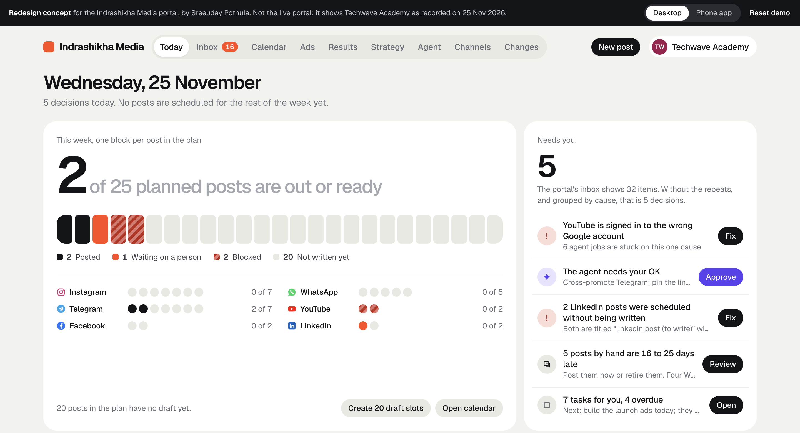

## What it shows

| Screen | The idea |
| --- | --- |
| Today | The week drawn as one block per planned post, coloured by state. Next to it, what needs a person, grouped by cause so one fix clears every post it blocks. |
| Inbox | One list for problems, approvals, agent requests, manual posts and tasks. Keyboard: J and K to move, Enter to act. Every action can be undone. |
| Calendar | Real posts plus outlined slots for posts the plan expects that nobody has written. Click a slot to write it. |
| New post | Opens with a draft ready for the chosen channel and a preview that looks like the real post. Checks block placeholder titles, empty captions and duplicate captions. |
| Ads | Launch readiness from the real open tasks, and a cost-per-sign-up guardrail that turns logged results into a plain verdict: scale, keep running or stop. |
| Budget | A spend slider with the plan's forecast, and one scale showing that the forecast sits far above the stop line. |
| Strategy | The maturity score, recalculated as you change a rating, and each part of the plan next to its status this week. |
| Agent | Each job lists its steps, marks the public ones, states the risk, and shows proof when it finishes. |
| Results | One stated definition of a sign-up, read by every screen. |
| Channels | One status per channel: posts itself, by hand, or blocked, with the fix. |
| What changed | Ten observations from the live portal, each matched to the screen that answers it. |

| Inbox | Calendar |
| --- | --- |
| 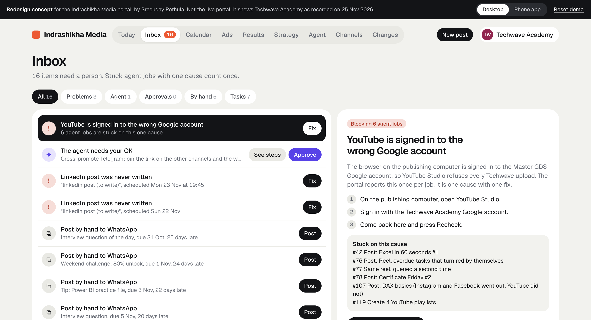 | 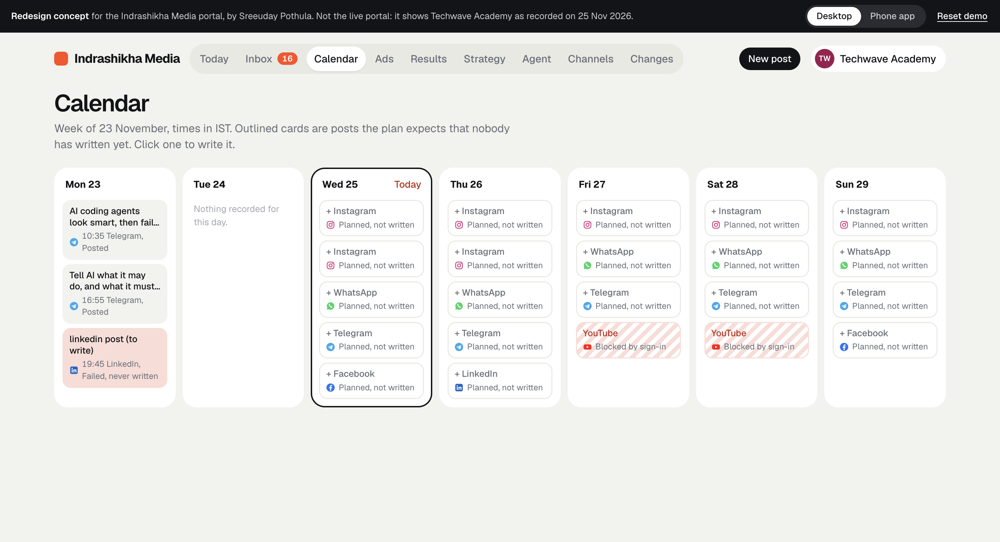 |

| New post | Results |
| --- | --- |
| 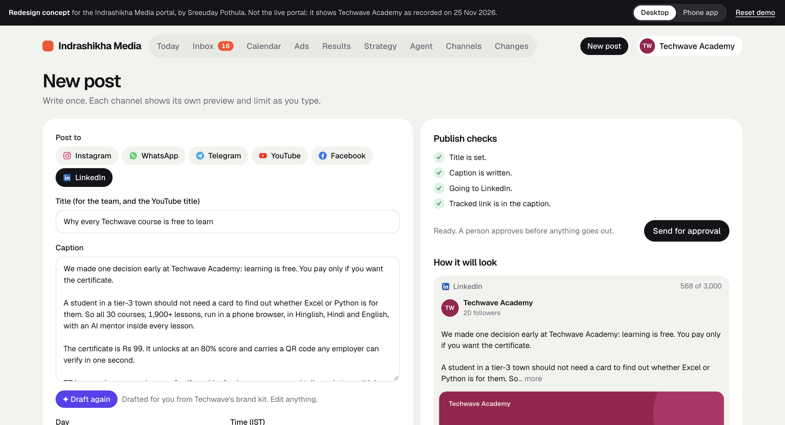 | 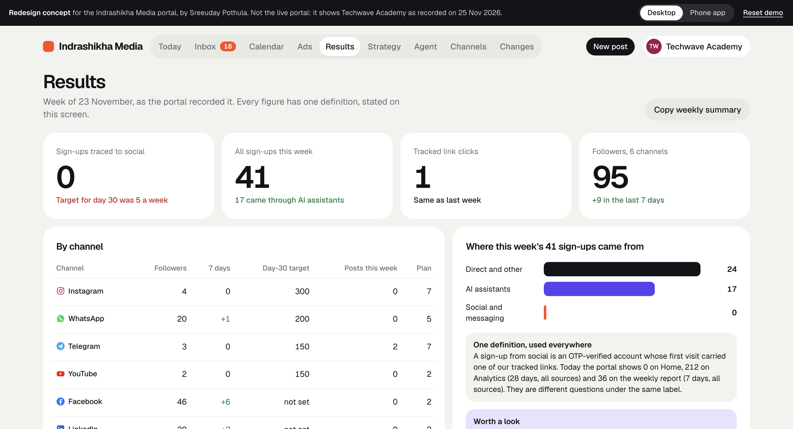 |

| Ads | Budget | Strategy |
| --- | --- | --- |
| 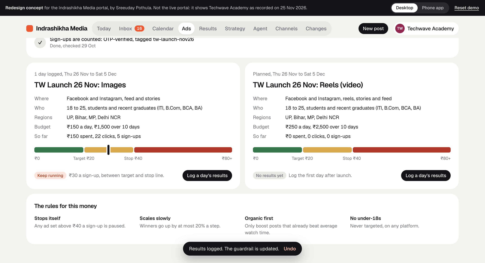 | 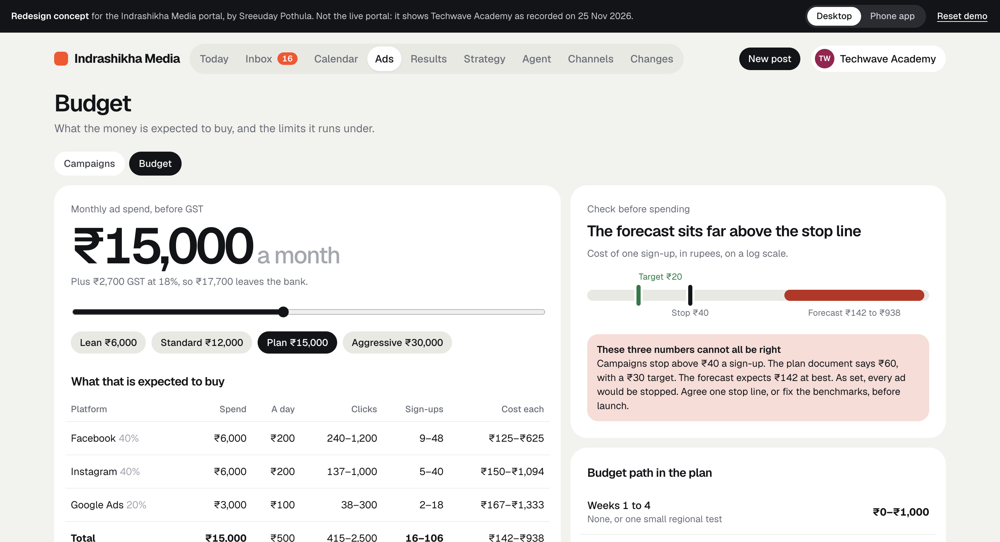 | 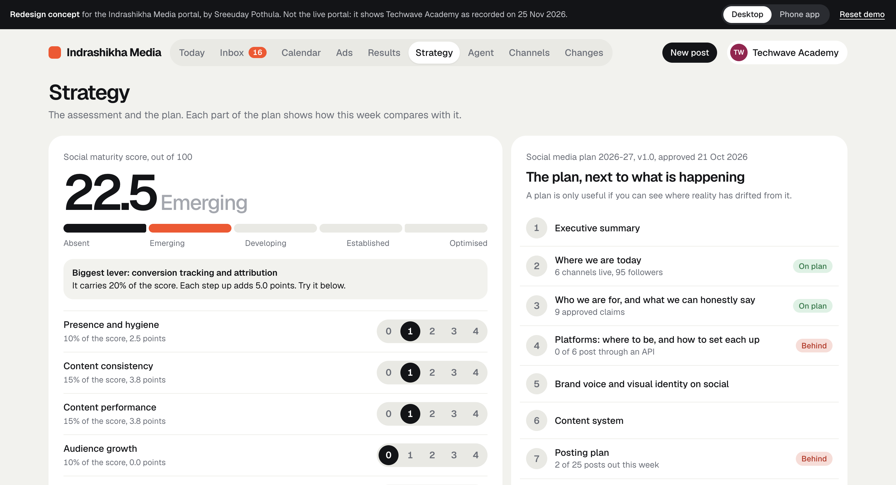 |

| Phone: Today | Phone: one fix for six stuck jobs | Phone: post preview |
| --- | --- | --- |
| 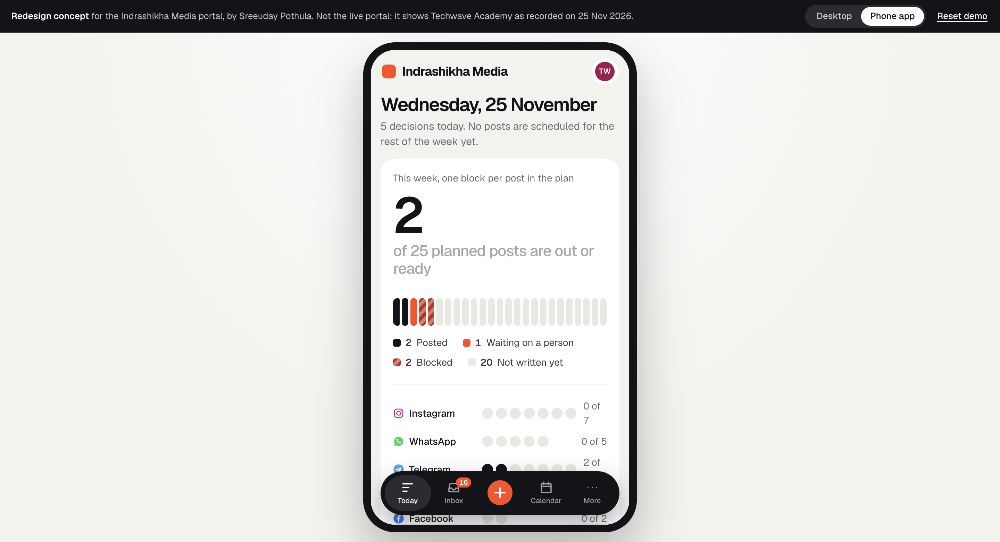 | 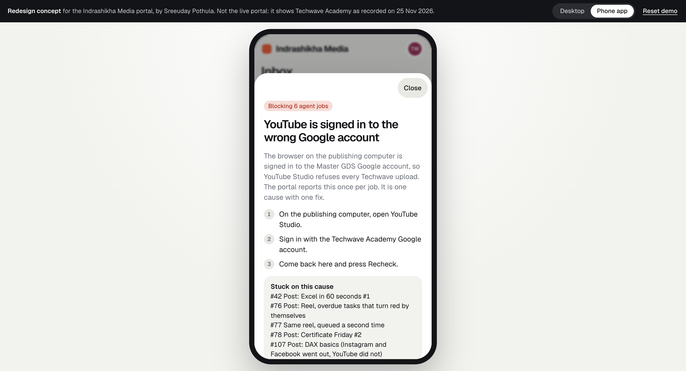 | 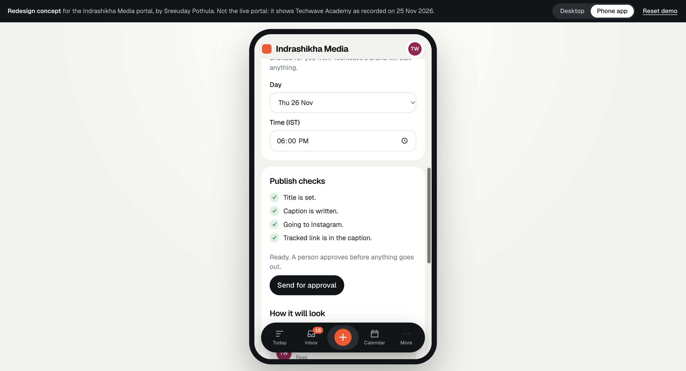 |

## Run it locally

Open `index.html` in a browser. There is no build step and no server.

`relay.html` is the source; `index.html` is the same file wrapped in a standard HTML page.

## What is real and what is not

- Real data: the project, channels, follower counts, plan rhythm, targets, overdue posts, tasks and agent jobs are what the portal showed for Techwave Academy on 25 November 2026. Personal emails, access tokens and internal file paths are left out.
- Real behaviour: every interaction, the grouping logic, the publish checks, undo, the keyboard shortcuts and the responsive phone layout.
- Simulated: the ready drafts are six prepared posts, one per channel, written from Techwave's own facts and not by a live model; the agent's progress after approval runs on timers, and "Recheck" assumes the YouTube sign-in was fixed.
- Not built: a server, sign-in and real channel connections. The review document describes the API and architecture I would build behind this.

Security observations from the review are shared privately with the Indrashikha team and are left out of this public copy.
